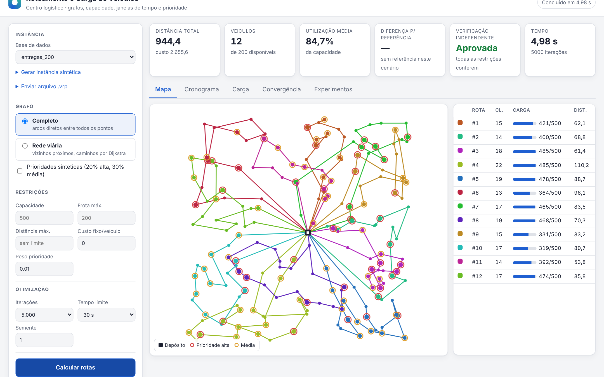
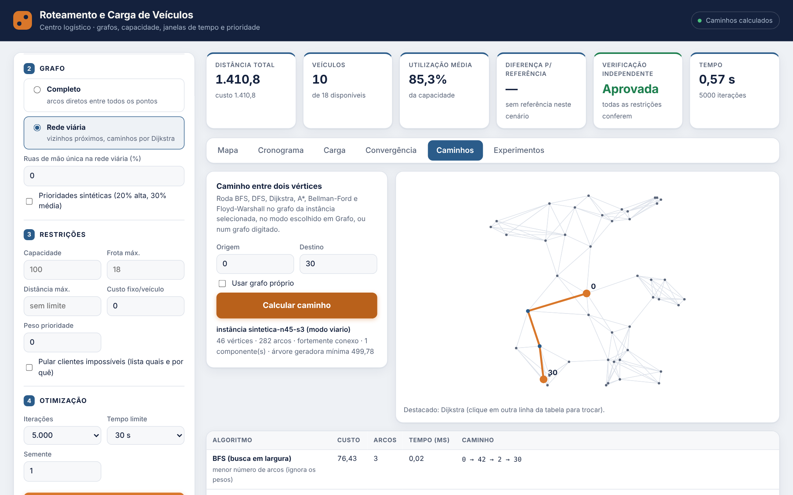
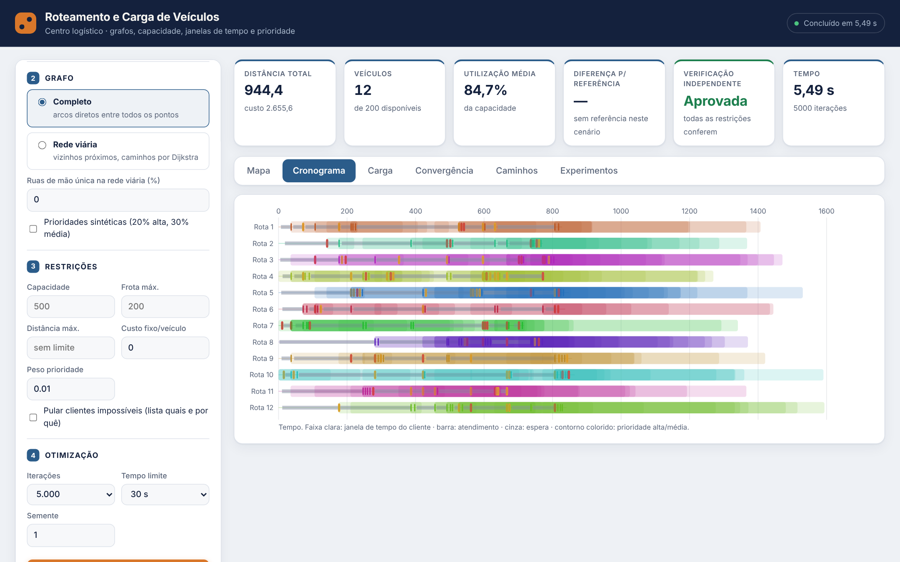
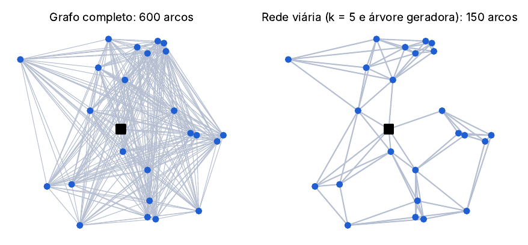
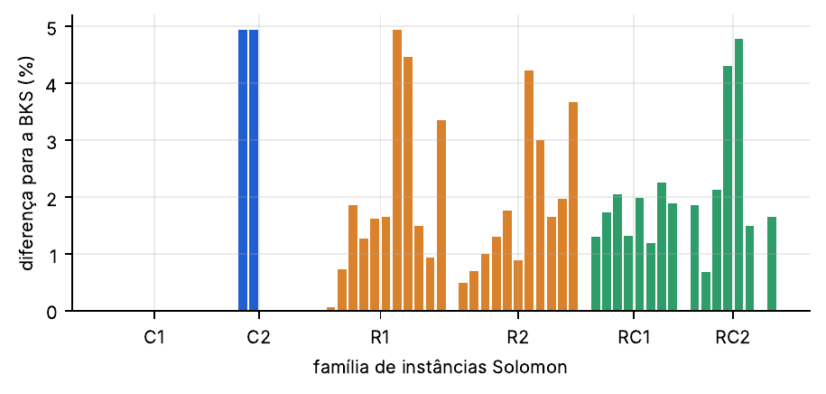
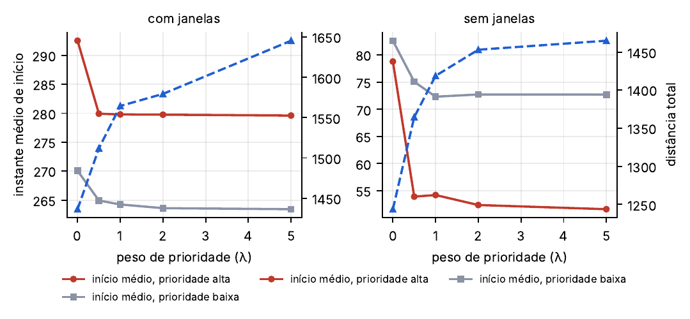
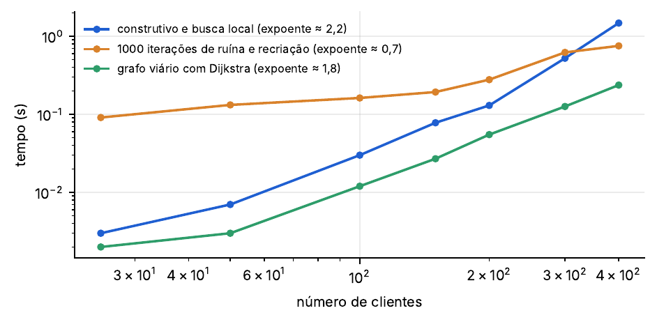

# Roteamento e Carga de Veículos em Centros Logísticos

Trabalho Prático de Teoria dos Grafos (PUC Minas, Engenharia de Software), Tema 10: uma ferramenta que planeja rotas
logísticas com restrições de **capacidade, janelas de tempo, distância máxima e prioridade**, modelando o problema
como um grafo dirigido ponderado. Escrita em Python, só com a biblioteca padrão.



| Material | Onde |
|---|---|
| Relatório final (PDF, template SBC) | [`relatorio/relatorio.pdf`](relatorio/relatorio.pdf) |
| Documento da Etapa 1 (PDF) | [`docs/etapa1/etapa1.pdf`](docs/etapa1/etapa1.pdf) |
| Código LaTeX dos relatórios | [`relatorio/relatorio.tex`](relatorio/relatorio.tex), [`docs/etapa1/etapa1.tex`](docs/etapa1/etapa1.tex) |
| Overleaf: relatório final | [abrir no Overleaf](https://www.overleaf.com/project/6b00aac124b84befa2a1f30f/share#0c7dd67ecd3bebbe4c59f043ec5f13555ae226be6c33a0ae) |
| Overleaf: Etapa 1 | [abrir no Overleaf](https://www.overleaf.com/project/6b00ab082077d3cd4f1aaa57/share#fbafc3277976c50dfa71bcb1935806b180efb8e328b35b65) |
| Zip com o LaTeX dos relatórios (pronto para o Overleaf) | [`entrega/latex_relatorios.zip`](entrega/latex_relatorios.zip) |
| Slides da apresentação (PDF) | [`apresentacao/slides.pdf`](apresentacao/slides.pdf) |
| Vídeo de demonstração | *(link a adicionar)* |
| Tutorial de uso | [`docs/tutorial.md`](docs/tutorial.md) |

## Como rodar em 1 minuto

Requer Python 3.10 ou mais novo. Não há nada para instalar.

```
python main.py
```

Abre a interface em `http://127.0.0.1:8000`. Escolha uma instância e clique em **Calcular rotas**. Pelo terminal:

```
python main.py resolver dados/solomon/R101.vrp
python main.py caminho --arestas "A B 4; A C 1; C B 1; B D 1" A D
python -m unittest discover -s testes -t .
```

## O que a ferramenta faz

- **Calcula rotas** que saem e voltam ao depósito, respeitando capacidade, janelas de tempo (com espera), distância
  máxima por rota, tamanho da frota, custo fixo por veículo e prioridade dos clientes.
- **Dois modelos de grafo:** completo, com arco entre todo par de pontos, ou rede viária, com os 5 vizinhos mais
  próximos e a árvore geradora mínima (Kruskal) para ficar conexa, opcionalmente com ruas de mão única. Na rede
  viária, o Dijkstra calcula a distância entre todo par de pontos e o mapa desenha o trajeto pelas ruas.
- **Mostra o resultado** em mapa, cronograma por veículo, carga e ordem de carregamento, convergência do custo e os
  experimentos já calculados.
- **Confere cada solução** com um verificador independente, que recalcula tudo sem usar as contas do solver.
- **Compara algoritmos de caminho:** BFS, DFS, Dijkstra, A*, Bellman-Ford e Floyd-Warshall lado a lado, entre dois
  vértices de uma instância ou de um grafo digitado (o menor caso é `A B 1`).
- **Explica os erros:** arquivo inválido, parâmetro fora da faixa, cliente impossível de atender. Tudo aparece em três
  partes, na tela e no terminal: o que aconteceu, por quê e o que fazer.

| Caminhos entre dois vértices | Cronograma por veículo |
|---|---|
|  |  |

## Modelagem

Grafo dirigido ponderado `G = (V, A, d, t)`: o vértice 0 é o depósito, os demais são clientes, e cada arco tem
distância `d` e tempo `t`. Uma solução é uma partição dos clientes em circuitos que saem e voltam ao depósito. O custo
é a distância total, mais um custo fixo por veículo e um termo de prioridade, `λ × Σ peso × início do atendimento`,
com pesos 3, 2 e 1 para prioridade alta, média e baixa.



## Algoritmos

| Etapa | Algoritmo | Arquivo |
|---|---|---|
| Caminhos mínimos | Dijkstra com heap binário | `logistica/caminhos.py` |
| Conexidade | Kruskal com union-find, BFS no grafo e no transposto | `logistica/grafo.py` |
| Solução inicial | Economias de Clarke-Wright e inserção de Solomon | `logistica/construtivo.py` |
| Avaliação | Folgas de tempo: testar uma inserção custa O(1) | `logistica/avaliacao.py` |
| Melhoria | Busca local (4 movimentos) e ruína e recriação com recozimento simulado | `logistica/busca_local.py`, `logistica/otimizador.py` |
| Validação | Verificador independente (Bellman-Ford) e solver exato até 9 clientes | `logistica/verificador.py`, `logistica/exato.py` |
| Caminho entre dois vértices | BFS, DFS, Dijkstra, A*, Bellman-Ford e Floyd-Warshall | `logistica/caminhos.py`, `logistica/consulta.py` |

### Sem bibliotecas de grafos

O enunciado proíbe bibliotecas prontas de grafos, como a NetworkX, salvo para comparação de desempenho. A ferramenta
não usa nenhuma: o grafo, o Dijkstra, o A*, o Bellman-Ford, o Floyd-Warshall, o Kruskal, o union-find e a BFS foram
escritos por nós. Duas importações que podem chamar atenção:

- **`heapq`:** é só a fila de prioridade da biblioteca padrão do Python, uma estrutura de dados como uma lista. O
  Dijkstra, o A* e o grafo foram escritos por nós.
- **`numpy`:** aparece só em `scripts/figuras.py`, para calcular a inclinação do gráfico de tempo do relatório. Não
  toca no grafo nem faz parte da ferramenta.

O teste `testes/test_sem_biblioteca_de_grafos.py` garante a regra: falha se qualquer arquivo da ferramenta importar
uma biblioteca de grafos e roda a ferramenta com essas bibliotecas bloqueadas.

A NetworkX aparece só na pasta [`comparacao_networkx/`](comparacao_networkx/README.md), isolada e **somente a título de
comparação**: com os mesmos grafos, as respostas foram iguais nos 34 casos, e a matriz de distâncias da nossa
implementação saiu 2,3 vezes mais rápida com 1001 vértices.

## Dados e benchmarks

| Base | O que é | Por que usamos |
|---|---|---|
| Solomon (56 instâncias) | 100 clientes, capacidade e janelas de tempo | benchmark clássico, com melhor solução conhecida (BKS) publicada |
| Conjunto X (9 instâncias) | 101 a 303 clientes, só capacidade | mede a qualidade em instâncias maiores e sem janelas |
| Gehring-Homberger, Kaggle (300 instâncias) | 200 a 1000 clientes, no formato de Solomon | escala, com BKS publicada para comparar |
| Entregas de e-commerce, Kaggle (1000 entregas) | latitude, longitude, peso, janela e prioridade reais | dado com cara de operação real; a prioridade vem do próprio arquivo |

Origem, licença e suposições de cada base (como o depósito no centroide das entregas) estão em
[`dados/README.md`](dados/README.md). Os experimentos ficam em [`resultados/`](resultados/README.md) e são refeitos com
`python main.py benchmark todos`: com a mesma semente, as distâncias saem iguais.

## Resultados

Todas as soluções abaixo foram aprovadas pelo verificador independente.

| Experimento | Resultado |
|---|---|
| Solomon, 56 instâncias | 1,49% acima da BKS em média; igual à BKS em 17 |
| Conjunto X, 9 instâncias | 2,10% acima da BKS em média |
| Gehring-Homberger, 200 clientes | igual à BKS em C1 e C2, com o mesmo número de veículos |
| Solver exato, 50 instâncias de 8 clientes | a heurística chegou ao ótimo em 50 de 50 |
| Entregas do Kaggle, 200 entregas | com prioridade (λ = 0,01), o atraso médio das de prioridade alta cai de 146 para 42 min, com 11,7% a mais de distância |
| Rede viária contra grafo completo | 494 arcos em vez de 6480, e trajetos 27,9% mais longos em média |
| Comparação com a NetworkX | respostas iguais nos 34 casos |





O tempo de cada fase cresce como a complexidade esperada; a busca local com filtros O(1) ficou de 2 a 8 vezes mais
rápida, com as mesmas rotas:



## Testes

São 88 testes automáticos (`python -m unittest discover -s testes -t .`, cerca de 20 s). Eles comparam cada peça com
uma forma independente de chegar ao mesmo resultado: Dijkstra contra Floyd-Warshall, Kruskal contra força bruta,
inserção O(1) contra recálculo completo, heurística contra solver exato, reprodução exata das 65 BKS e erros sempre
explicados, sem traceback. Detalhes em [`testes/README.md`](testes/README.md).

## Estrutura do repositório

```
logistica/            código da ferramenta (modelo, grafo, algoritmos, serviço, servidor e interface web)
testes/               testes automáticos
dados/                Solomon, conjunto X e as duas bases do Kaggle
exemplos/             casos-limite para testar na hora: 2 vértices, grafo digitado e arquivos inválidos
resultados/           CSV dos experimentos
comparacao_networkx/  só a título de comparação: os mesmos grafos na NetworkX (a ferramenta não a usa)
docs/                 Etapa 1, diagramas UML, tutorial, matriz de rastreabilidade e imagens deste README
relatorio/            relatório final em LaTeX (template SBC) e PDF
apresentacao/         slides da apresentação em PDF
entrega/              zip com o LaTeX dos dois relatórios, pronto para o Overleaf
scripts/              geração das tabelas, figuras e prints do relatório, e o zip de entrega
```

Cada pasta tem um README explicando o que tem dentro.

## Equipe

João Gabriel Maia da Costa, Pedro Eduardo Pimenta e Thomas Ramos Oliveira. Cada integrante desenvolveu sua parte em
uma branch própria, integrada à `main` com merge commit; o que cada um fez está na Seção 10 do relatório.
